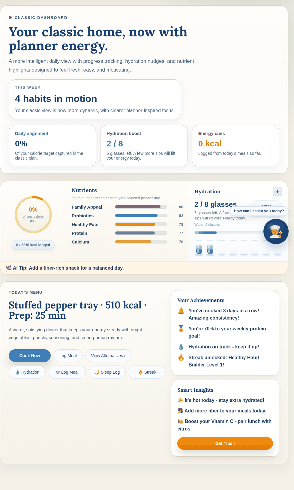
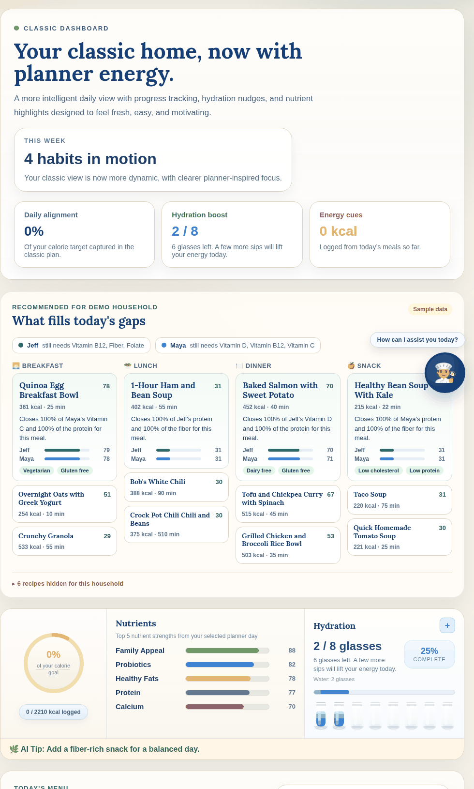
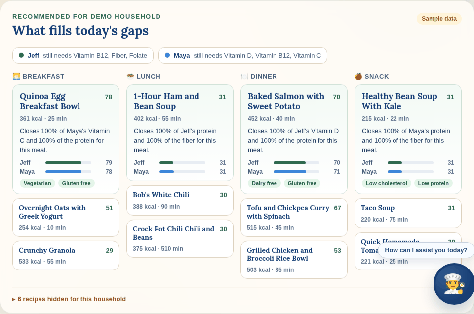
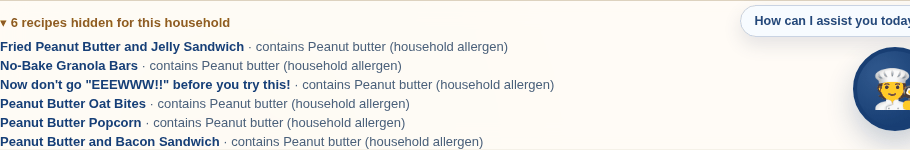
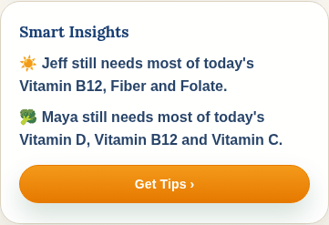
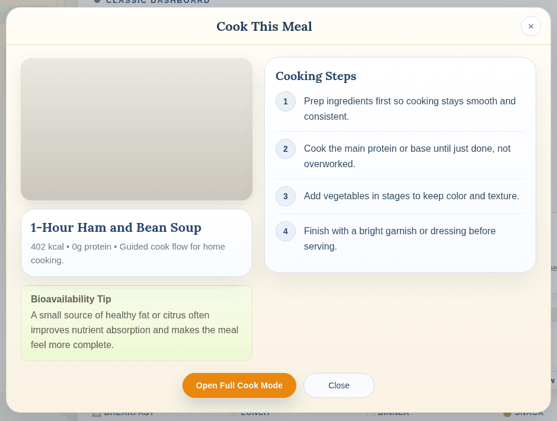

# Home page

`HomeDashboardClassic.jsx` is the page. `RecommendedMeals.jsx` is the new
recommendation section. `homeData.js` fetches the data.

## What changed

Before, everything on the home page was fixed text. Today's Menu came from a
sample weekly plan, the nutrient bars were made-up percentages, Smart Insights
and Achievements were hardcoded strings. Nothing was computed from the
household.

Now there is a recommendation section under the hero, and Smart Insights reads
from real nutrient gaps. Everything in the new section comes from one database
call, `fn_home`, which runs the recommender for the household.

| Before | After |
|---|---|
|  |  |

### The new section



Top to bottom:

- **Header** with the household name and a badge: "Live" when the data came
  from Supabase, "Sample data" when it came from the bundled snapshot.
- **Member chips.** For each household member, the nutrients they still need
  most of today (more than half the daily target still open).
- **Four meal columns**, Breakfast / Lunch / Dinner / Snack. The first card in
  each column is the top pick, with:
  - the household score (the lowest member's score, so nobody's needs get
    averaged away),
  - calories and total time,
  - a reason in plain words, for the member who needs it most:
    "Closes 100% of Maya's Vitamin C and 100% of the protein for this meal",
  - a score bar per member,
  - dietary tags from the recipe (vegan, gluten free, ...).

  The two cards below it are the runners-up. Clicking any card opens the
  existing Cook This Meal view.
- **Hidden recipes.** Collapsed by default. Recipes the household will never
  see and why, e.g. the peanut ones when a member has a peanut allergy.



### Smart Insights

Was three fixed tips. Now one line per member, from the same gap data.



### Cook This Meal

Unchanged. The steps it shows are still the generic placeholders from before;
the real steps are in `recipe_steps` and aren't wired in yet.



### Not changed

Hero card, calorie ring, the Nutrients bars, hydration, sleep, streaks,
achievements, Today's Menu. Those still work the way they did.

## Where the data comes from

`fn_home(household_id, date)` in `recommender/db/98_home.sql` returns the top
picks per meal slot with a score for each member, each member's open nutrient
gaps, and the recipes hidden for this household. One round trip.

When `VITE_SUPABASE_URL` and `VITE_SUPABASE_ANON_KEY` are set, the page calls
`supabase.rpc('fn_home', ...)`. When they aren't, or the call fails, it uses
`homeSnapshot.json`, a saved copy of that output for the demo household, and
shows the "Sample data" badge. Same code path either way.

To refresh the snapshot after changing the recommender or the recipes:

```bash
psql -d mazimeal_full -At -c "select fn_home('01930000-0000-7000-8000-0000000000b1', current_date, 3)" \
  | python3 -m json.tool > web/src/features/home/homeSnapshot.json
```

## Files

| file | what |
|---|---|
| `HomeDashboardClassic.jsx` | the page, moved here from `SynergiaLightApp.jsx` |
| `RecommendedMeals.jsx` | the new section |
| `homeData.js` | `loadHome()`, label helpers, the reason sentence |
| `homeSnapshot.json` | `fn_home` output for the demo household |
| `../../shared/theme/colors.js` | colour tokens, moved out of the big file |
| `../../shared/nutrition/calorieTarget.js` | calorie target helpers, same |

## Going live

The schema and seed need to be on Supabase, and `fn_home` needs to be callable
by the anon key. Not done yet; needs the database password.
