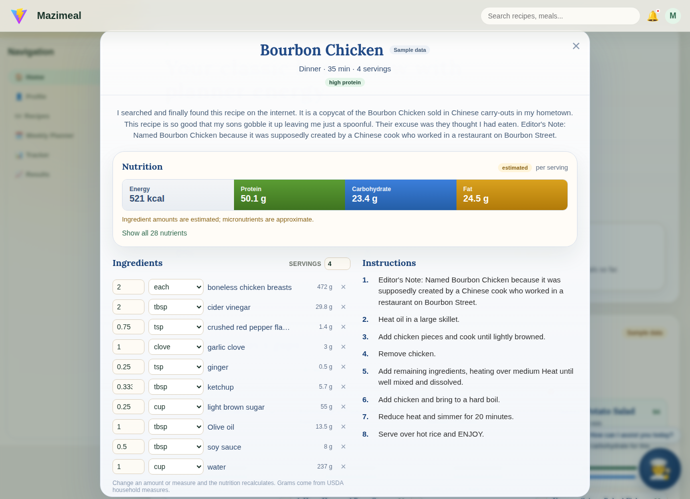
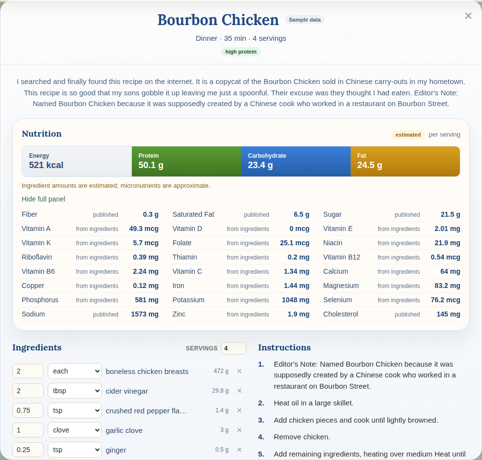
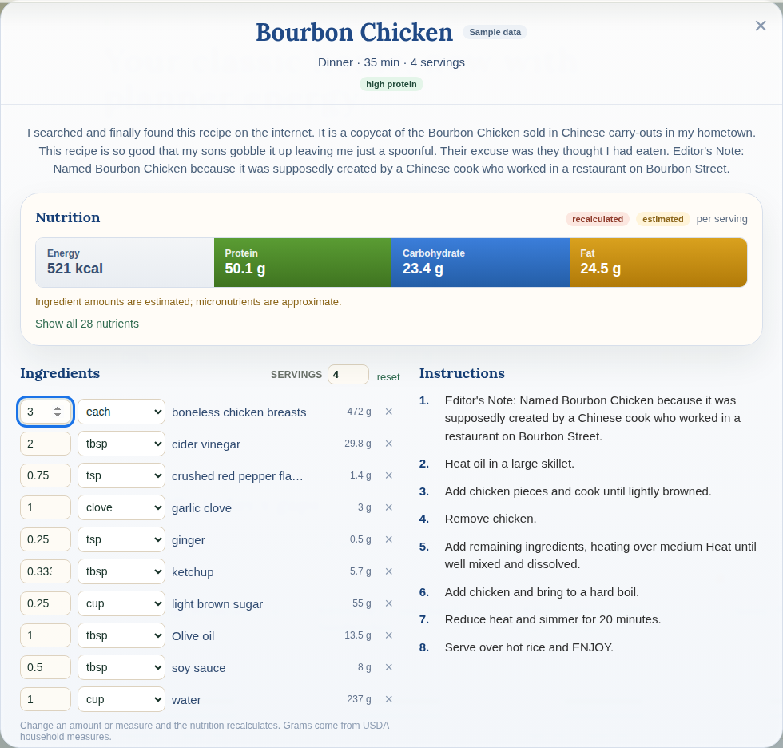

# Recipe screen

`RecipeDetail.jsx` is the screen. `recipeData.js` fetches the data. Opens
from a recommended meal on the home page; any place that has a `recipe_id`
can open it.



## What's on it

Everything comes from the database. Three reads when it opens: the recipe
row (name, description, time, servings, meal type, tags), `recipe_steps`,
and `fn_recipe_nutrition(recipe_id)`, which returns the ingredient lines with
grams and the nutrition panel in one call.

**Nutrition.** Four tiles (energy, protein, carbohydrate, fat) and "show all"
for the full list. Each nutrient says where it came from: "published" is the
value Food.com gives for the recipe, "from ingredients" is calculated from
the ingredient grams and the USDA values per 100 g. An "estimated" badge with
a sentence under the tiles appears when the recipe's data quality record says
the gram estimates were rough (see `mv_recipe_quality`).



**Ingredients.** Each line has an amount, a measure and the grams it works
out to. The measure dropdown lists the household measures USDA publishes for
that ingredient (cup, tbsp, large, clove...). Change an amount or measure,
remove a line, or change the serving count, and the panel recalculates
through `fn_recipe_nutrition(recipe_id, overrides, servings)`. The badge
switches to "recalculated", changed tiles show the previous value, and
"reset" puts everything back. Nothing is saved; this is what-if, not editing
the recipe.



**Instructions.** `recipe_steps` in order, with the step's duration when
there is one.

**Log this meal.** Tick who ate, set servings each, and `fn_log_meal` writes
one history row per person with the nutrients frozen as shown (including
any changes made above), adds them to each person's daily totals, and the
home page reloads so the gaps and recommendations move. The log id is
generated in the browser, so a retried request can't count a meal twice.
Needs the live database; disabled on sample data.


**Cook this** hands the recipe to the existing cook-mode popup. **Keep
browsing** closes.

## Without Supabase

`recipeSnapshot.json` is one recipe's data from the live database (Bourbon
Chicken), so the screen renders with a "Sample data" badge when the
`VITE_SUPABASE_*` variables aren't set. Recalculation returns the snapshot
unchanged in that mode. To refresh it:

```bash
psql "$DATABASE_URL" -At -c "SELECT jsonb_pretty(jsonb_build_object('recipe', jsonb_build_object('recipe_id', r.recipe_id, 'recipe_name', r.recipe_name, 'recipe_description', r.recipe_description, 'prep_time_min', r.prep_time_min, 'cook_time_min', r.cook_time_min, 'servings', r.servings, 'meal_category', r.meal_category, 'dietary_tags', r.dietary_tags, 'difficulty_level', r.difficulty_level), 'steps', (SELECT jsonb_agg(jsonb_build_object('step_number', s.step_number, 'instruction', s.instruction, 'duration_min', s.duration_min, 'timing_note', s.timing_note) ORDER BY s.step_number) FROM recipe_steps s WHERE s.recipe_id = r.recipe_id), 'nutrition', fn_recipe_nutrition(r.recipe_id))) FROM recipes r WHERE r.recipe_name = 'Bourbon Chicken'" > web/src/features/recipe/recipeSnapshot.json
```

## Not yet

Images (the URL is in the raw Food.com table, not on `recipes` yet),
favorites, the swap and bioavailability text, and saving an edited version.
Each of those is on the list in `docs/RECIPE_DATA.md`.
